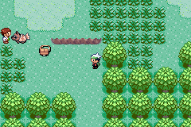
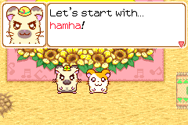
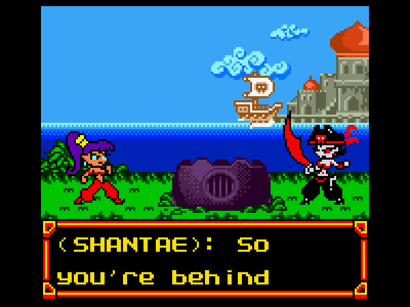
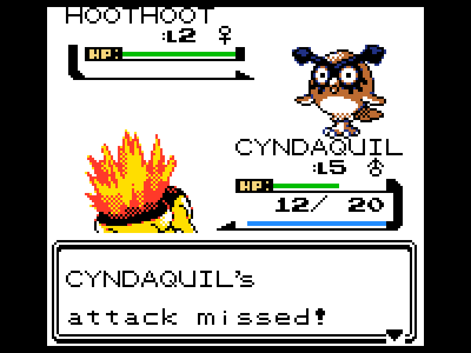
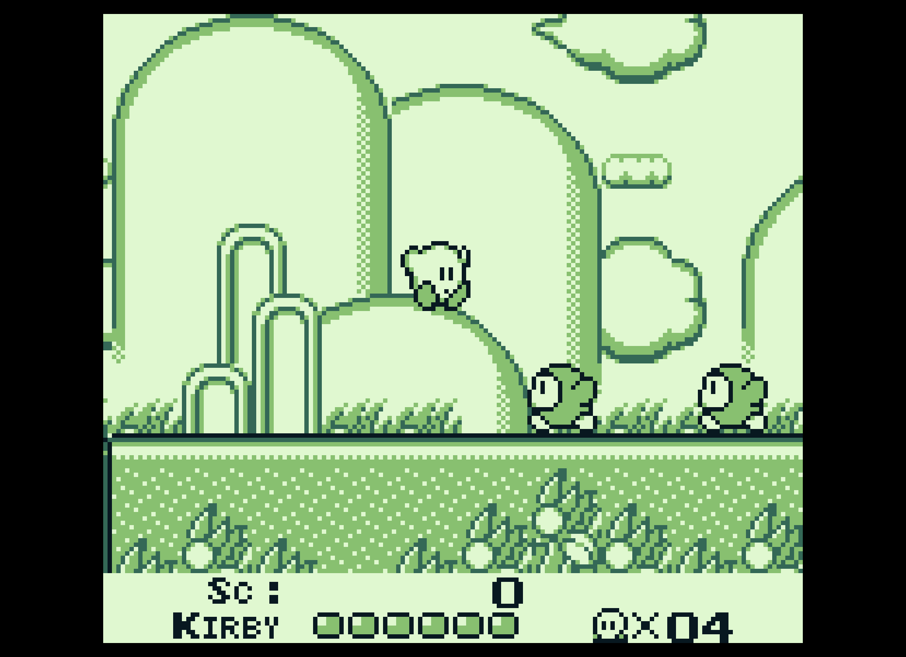
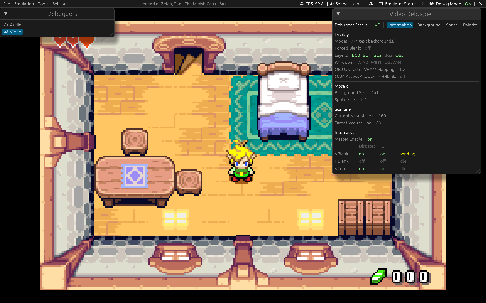
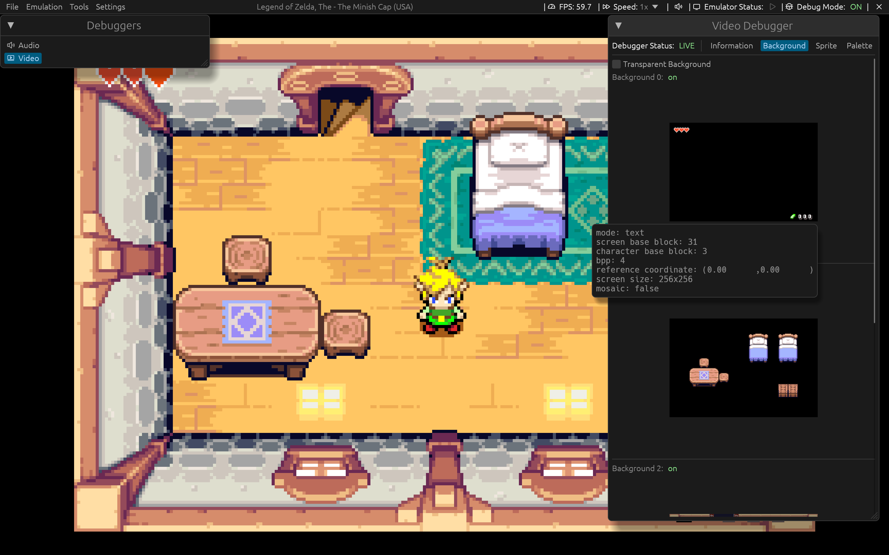
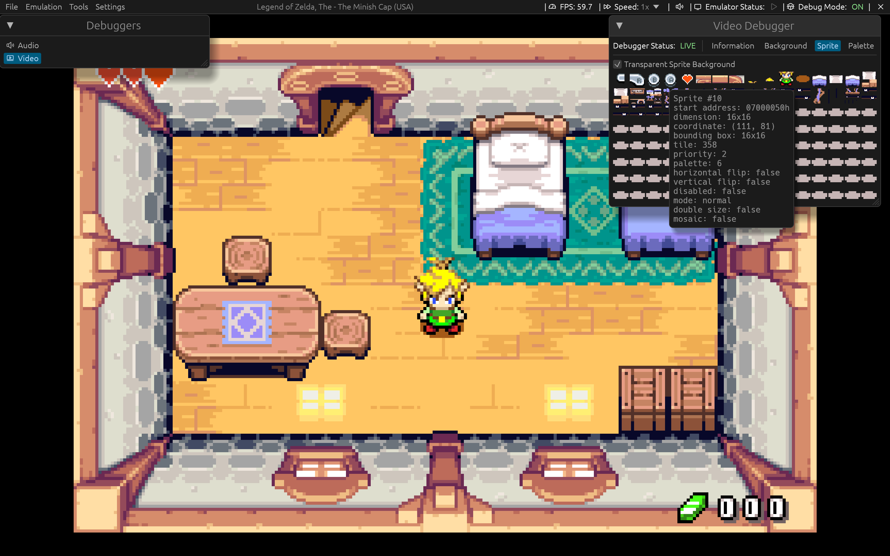
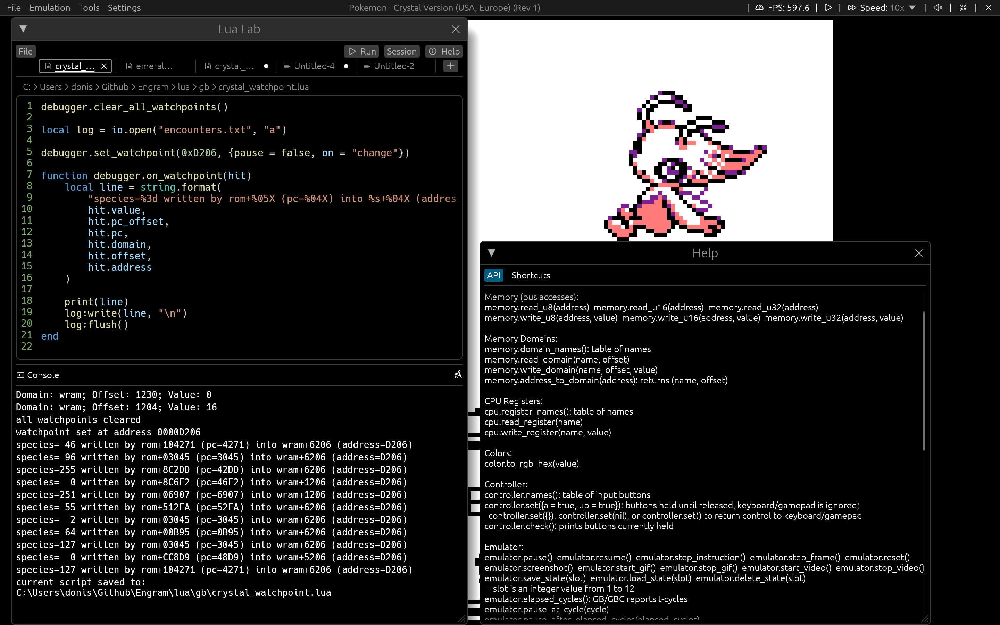

# Engram

[](https://github.com/donishadsmith/Engram/actions/workflows/test.yml)
[](https://github.com/donishadsmith/Engram/actions/workflows/build.yml)


A Game Boy Advance & Game Boy/Game Boy Color emulator.

<table align="center">
  <tr>
    <td align="center">
      
      <br>Megaman Battle Network 6 (GBA)
    </td>
    <td align="center">
      
      <br>Pokemon Emerald (GBA)
    </td>
    <td align="center">
      
      <br>Hamtaro Ham Ham Heartbreak (GBA)
    </td>
  </tr>
  <tr>
    <td align="center">
      
      <br>Shantae (GBC)
    </td>
    <td align="center">
      
      <br>Pokemon Crystal (GBC)
    </td>
    <td align="center">
      
      <br>Kirby's Dream Land (GB)
    </td>
  </tr>
</table>

https://github.com/user-attachments/assets/f0f28677-94f4-428d-a515-91e8717f488d

<p align="center"><sub>All game screenshots, GIFs, and video above were captured with Engram's built-in capture tools</sub></p>

## Features
**Systems**
- Game Boy and Game Boy Color: MBC1, MBC2, MBC3 with RTC, MBC5, and HuC1 cartridges
- Game Boy Advance: SRAM, Flash, EEPROM, RTC, solar sensor, and GPIO cartridges

PlayStation 1 is extremely WIP.

**Frontend**
- Save states and game saves
- Rebindable keyboard, hotkey and controller inputs
- Controller rumble
- Screenshots, GIFs, and video recordings
- Fast forward
- Solar sensor slider for Boktai
- Settings saved in [`config.toml`](https://github.com/donishadsmith/Engram#file-locations)

**Debuggers** (GBA only for now)
- Video: backgrounds, sprites, palettes, and register state
- Audio: per-channel visualization and register state

<table align="center">
  <tr>
    <td align="center">
      
      <br>Display and interrupt state
    </td>
    <td align="center">
      
      <br>Background layers
    </td>
    <td align="center">
      
      <br>Sprites (OAM)
    </td>
  </tr>
</table>

**Lua scripting** (`F8` or Tools menu)
- Breakpoints and read/write watchpoints with width, target/compare, change, and accessor filters
- Per-frame, breakpoint, and watchpoint callbacks
- Read and write memory by domain and CPU registers by name
- Set controller inputs and pause after a number of cycles
- Scripts run as coroutines, so they can pause, step, reset, and wait on the emulator mid-script
- Built-in editor and console ("Lua Lab")

<p align="center">
  
  <br><sub>Logging writes to Pokemon Crystal's species byte after a previous script modified RAM to make the best Pokemon (Celebi) shiny</sub>
</p>

## Usage
```bash
git clone https://github.com/donishadsmith/Engram
cd Engram
cargo run --release
```

**Note**: Video recording requires [ffmpeg](https://ffmpeg.org/download.html) in your `PATH`.

### Linux dependencies
Additional dependencies for audio (cpal), rednering/windowing (macroquad) and controllers (gilrs) are required:

```bash
# debian and ubuntu
apt install pkg-config libx11-dev libxi-dev libgl1-mesa-dev libasound2-dev libudev-dev libwayland-dev

# fedora
dnf install libX11-devel libXi-devel mesa-libGL-devel alsa-lib-devel

# arch linux
pacman -S pkg-config libx11 libxi mesa-libgl alsa-lib
```

### Sony controllers on Window
Inputs work with no additional software, but rumble does not. Use [Ds4 Windows](https://ds4-windows.com/download/) to present the controller as an Xbox 360 controller and leave "Hide DS4 Controller" off.

## File Locations
Default locations use your platform's standard directories (via [`dirs`](https://docs.rs/dirs/latest/dirs/)). Save and recording locations can be changed under *Settings* -> *Choose Data Locations*.

|   | Linux | macOS | Windows |
|---|-------|-------|---------|
| **Game saves and save states**<br>`{system}/saves/` and `{system}/states/` | `$XDG_DATA_HOME/Engram/` or<br>`$HOME/.local/share/Engram/` | `$HOME/Library/Application Support/Engram/` | `%AppData%\Engram\` |
| **Settings**<br>`config.toml` | `$XDG_CONFIG_HOME/Engram/` or<br>`$HOME/.config/Engram/` | `$HOME/Library/Application Support/Engram/` | `%AppData%\Engram\` |
| **Screenshots and GIFs** | `$XDG_PICTURES_DIR` | `$HOME/Pictures` | `%UserProfile%\Pictures` |
| **Videos** | `$XDG_VIDEOS_DIR` | `$HOME/Movies` | `%UserProfile%\Videos` |

## References
I heavily relied on the prior work of the emulation development community while developing my own emulators. In particular, [mGBA](https://github.com/mgba-emu/mgba), [NanoBoyAdvance](https://github.com/nba-emu/NanoBoyAdvance), [rustboyadvance-ng](https://github.com/michelhe/rustboyadvance-ng), [retroboy](https://github.com/smparsons/retroboy), [SameBoy](https://github.com/LIJI32/SameBoy), [Pan Docs](https://gbdev.io/pandocs/), and [GBATEK](https://problemkaputt.de/gbatek.htm) were incredibly helpful. The full list of emulators, documentation, and articles used is in [REFERENCES.md](REFERENCES.md).
