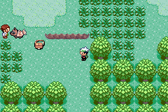
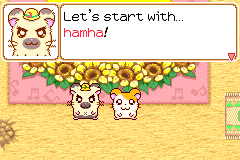
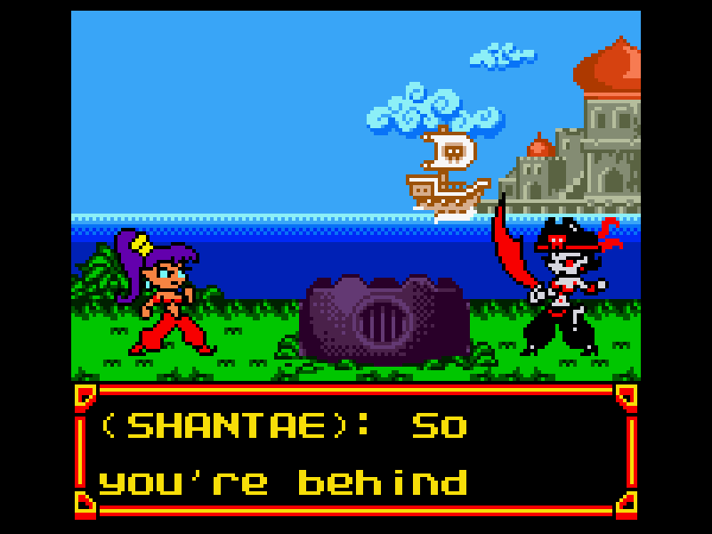
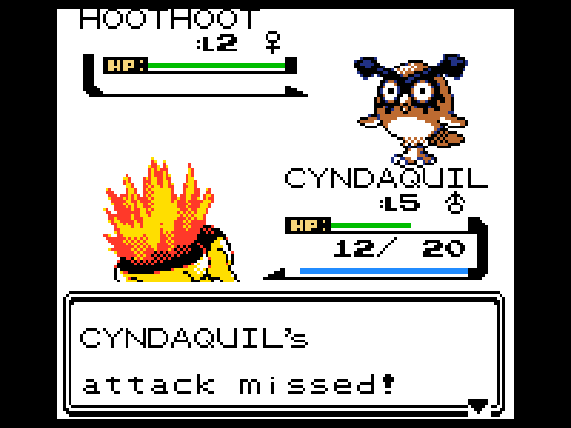
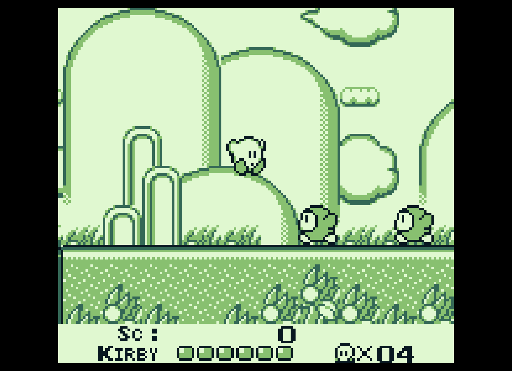

# Engram

[](https://github.com/donishadsmith/Engram/actions/workflows/test.yml)
[](https://github.com/donishadsmith/Engram/actions/workflows/build.yml)

A Game Boy Advance & Game Boy/Game Boy Color emulator.

<table align="center">
  <tr>
    <td align="center">
      
      <br>Megaman Battle Network 6 (GBA)
    </td>
    <td align="center">
      
      <br>Pokemon Emerald (GBA)
    </td>
    <td align="center">
      
      <br>Hamtaro Ham Ham Heartbreak (GBA)
    </td>
  </tr>
  <tr>
    <td align="center">
      
      <br>Shantae (GBC)
    </td>
    <td align="center">
      
      <br>Pokemon Crystal (GBC)
    </td>
    <td align="center">
      
      <br>Kirby's Dream Land (GB)
    </td>
  </tr>
</table>

## Features
**Systems**
- Game Boy and Game Boy Color: MBC1, MBC2, MBC3 with RTC, MBC5 and HuC1 cartridges
- Game Boy Advance: SRAM, Flash, EEPROM, RTC, solar sensor and GPIO cartridges
- PlayStation (early work in progress)

**Frontend**
- Save states and game saves
- Rebindable keyboard, hotkey and controller inputs
- Controller rumble
- Screenshots and GIF recording
- Fullscreen, volume, and solar sensor slider for Boktai
- Settings saved in [`config.toml`](https://github.com/donishadsmith/Engram#settings)
- Windows, MacOS, Linux

Built with [macroquad](https://github.com/not-fl3/macroquad), [egui](https://github.com/emilk/egui), [cpal](https://github.com/RustAudio/cpal), [blip_buf](https://github.com/mvdnes/blip_buf-rs), [gilrs](https://gitlab.com/gilrs-project/gilrs), and [mlua](https://github.com/mlua-rs/mlua).

**Debuggers** (GBA only for now)
- Video: backgrounds, sprites, palettes, and register state
- Audio: per-channel visualization and register state

**Lua scripting** (`F8` or Tools menu)
- Breakpoints and read/write watchpoints (byte, halfword, word) with callbacks
- Per-frame callbacks
- Read and write memory by domain and CPU registers by name
- Set controller inputs and pause after a number of cycles
- Built-in editor with console output

## Usage
```bash
git clone https://github.com/donishadsmith/Engram
cd Engram
cargo run --release
```

### Linux
Additional dependencies for audio (cpal), windowing (macroquad) and controllers (gilrs) are required:

```bash
# for macroquad
# ubuntu system dependencies
apt install pkg-config libx11-dev libxi-dev libgl1-mesa-dev libasound2-dev

# fedora system dependencies
dnf install libX11-devel libXi-devel mesa-libGL-devel alsa-lib-devel

# arch linux system dependencies
pacman -S pkg-config libx11 libxi mesa-libgl alsa-lib

# for gilrs
# debian
apt install libudev-dev

# for cpal
# debian and ubuntu
apt install libwayland-dev

# fedora
dnf install alsa-lib-devel
```

### Windows
While Sony controllers inputs work with no additional software, rumble does not. Recommended to use [Ds4 Windows](https://ds4-windows.com/download/) to present it as an Xbox 360 controller. Connect over USB and leave "Hide DS4 Controller" off.

## Save Data
Game saves and save states are stored inside your platform's data directory (via [`dirs::data_dir`](https://docs.rs/dirs/latest/dirs/fn.data_dir.html)), in `Engram/{system}/saves/` and `Engram/{system}/states/` respectively:

- Linux: `$XDG_DATA_HOME/Engram/` or `$HOME/.local/share/Engram/`
- MacOS: `$HOME/Library/Application Support/Engram/`
- Windows: `%AppData%\Engram\`

## Settings
Settings are saved to `Engram/config.toml` inside your platform's config directory (via [`dirs::config_dir`](https://docs.rs/dirs/latest/dirs/fn.config_dir.html)):

- Linux: `$XDG_CONFIG_HOME/Engram/` or `$HOME/.config/Engram/`
- MacOS: `$HOME/Library/Application Support/Engram/`
- Windows: `%AppData%\Engram\`

## References
I heavily relied on the prior work of the emulation development community while developing my own emulators. In particular, [mGBA](https://github.com/mgba-emu/mgba), [NanoBoyAdvance](https://github.com/nba-emu/NanoBoyAdvance), [rustboyadvance-ng](https://github.com/michelhe/rustboyadvance-ng), [retroboy](https://github.com/smparsons/retroboy), [SameBoy](https://github.com/LIJI32/SameBoy), [Pan Docs](https://gbdev.io/pandocs/), and [GBATEK](https://problemkaputt.de/gbatek.htm) were incredibly helpful. The full list of emulators, documentation, and articles used is in [REFERENCES.md](REFERENCES.md).
